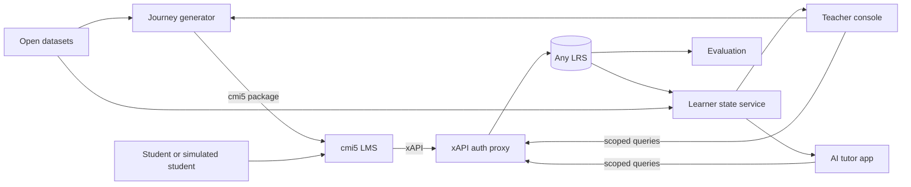

# Open Formative Assessment Lab (OFAL)

**An open, runnable harness for teacher–AI coordination in K-12 formative assessment.**

OFAL helps edtech developers *see*, *try*, and *adopt* open education resources such as misconception graphs, knowledge graphs, and tutoring benchmarks. The goal: one `docker compose up` gives a developer a working stack where every AI decision and every teacher action can be watched as open xAPI data.

> **Status:** Planning, launching 2027. Watch or star the repo to follow along.

## Why
Open resources for AI in education exist, but developers rarely use them. Each one takes weeks to find, license-check, wire up, and evaluate. OFAL aims to cut that friction and make the benefit measurable, while teachers stay in the loop and in control.

## What's planned
| Component | Purpose |
|---|---|
| **Journey generator** | AI builds standard cmi5 learning journeys from grade level and learning objectives |
| **Barebones cmi5 LMS** | A lightweight, standalone cmi5 player |
| **Teacher console** | Approve journeys, control gates, override AI decisions, see alerts |
| **xAPI auth proxy** | Security and scoped queries for teacher and AI apps ([xapi-lrs-auth-proxy](https://github.com/tla-ecosystem/xapi-lrs-auth-proxy)) |
| **LRS-agnostic storage** | Works with any conformant xAPI LRS |
| **Learner state service** | Turns xAPI evidence into learner states, following emerging IEEE learner-state work |
| **Simulation sandbox** | Simulated students and teachers generate open, synthetic xAPI data |
| **Evaluation harness** | Benchmarks and A/B tests to show what actually helps |
| **Dataset adapters** | Bring open datasets into xAPI and competency formats in minutes, not weeks |

## Architecture

## Teacher–AI coordination (planned)
1. AI drafts a learner journey, and the teacher approves it.
2. The teacher sees each student's learner state and misconceptions.
3. The teacher approves or overrides AI gate decisions, and the reason is logged.
4. AI flags a stuck student, and the teacher chooses whether to step in or let AI tutor.

## Open by design
- **Code:** Apache-2.0
- **Data and synthetic corpora:** CC-BY-4.0
- **Dependencies:** openly licensed only. Every part is swappable: the LRS, the AI model, the tutor, and the competency framework.

## Contributing
Developers, teachers, and researchers are welcome. Open an issue to share how you would use OFAL or what gets in your way today. See [CONTRIBUTING.md](CONTRIBUTING.md).

## License
Code is licensed under Apache-2.0 (see [LICENSE](LICENSE)). Data and documentation are licensed under CC-BY-4.0 (see [LICENSE-DATA.md](LICENSE-DATA.md)).
